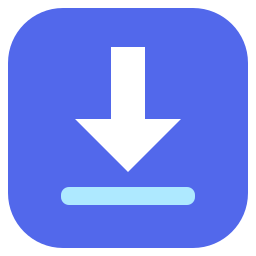
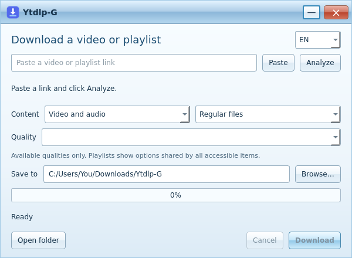

<div align="center">
  
  <h1>Ytdlp-G</h1>
  <p><strong>Paste a link. Pick your quality. Download.</strong></p>
  <p>A compact Windows app for videos, playlists and high-quality MP3,<br>with a familiar Windows 7 Aero-inspired look.</p>
  <p>
    <a href="https://github.com/fuhbe/Ytdlp-G/releases/latest"></a>
    
    <a href="LICENSE"></a>
  </p>
  <p>
    <a href="https://github.com/fuhbe/Ytdlp-G/releases/latest/download/Ytdlp-G-Setup.exe"><strong>Download for Windows</strong></a>
    · <a href="https://github.com/fuhbe/Ytdlp-G/releases/latest/download/Ytdlp-G-portable.zip">Portable ZIP</a>
    · <a href="https://github.com/fuhbe/Ytdlp-G/releases/latest">Release notes & checksums</a>
  </p>
  <p><a href="README.pt-BR.md">Português</a> · English · <a href="README.es.md">Español</a></p>
</div>

<p align="center">
  
  <br><sub>Actual application UI, captured with Qt on Linux. Windows packages are available below.</sub>
</p>

## Simple by design

Ytdlp-G brings [yt-dlp](https://github.com/yt-dlp/yt-dlp) and
[FFmpeg](https://ffmpeg.org/) into a small **600 × 440** desktop window.
The controls you need fit on one screen.

- **Videos and playlists:** paste one link and analyze the available formats.
- **Available qualities:** choose native video or audio formats reported by the source.
  Playlists show options shared by all accessible items.
- **High-quality MP3:** download the best available audio and convert it to MP3 at
  320 kbps. Existing MP3 sources are preserved without another lossy conversion.
- **Files or ZIP:** save regular media files or one ZIP for the link or playlist.
- **Clear Aero-inspired interface:** light dropdowns, readable selection colors
  and a familiar blue window frame.
- **Three languages:** English, Brazilian Portuguese and Spanish, switchable in the app.
- **Ready to run:** Python, Qt, yt-dlp, FFmpeg/FFprobe and QuickJS-ng are bundled.
  No Python installation or terminal commands needed.

MP3 conversion cannot improve the original recording. Native audio choices keep
the source codec, and video is downloaded/remuxed without re-encoding.

## Download for Windows

**Windows 10/11, 64-bit.** The Aero style is visual; Windows 7 is not supported.

| Package | How to use |
| --- | --- |
| [Installer — Ytdlp-G-Setup.exe](https://github.com/fuhbe/Ytdlp-G/releases/latest/download/Ytdlp-G-Setup.exe) | Run the installer. Installs for your user without administrator access. |
| [Portable — Ytdlp-G-portable.zip](https://github.com/fuhbe/Ytdlp-G/releases/latest/download/Ytdlp-G-portable.zip) | Extract the entire ZIP and open **Ytdlp-G.exe**. Keep `_internal`, `licenses` and `portable.flag` beside it. |

The packages include the media tools and runtime, so the downloads are about
153 MB (installer) and 219 MB (portable ZIP). The binaries are currently unsigned;
Windows SmartScreen may display a warning.
[SHA256 checksums](https://github.com/fuhbe/Ytdlp-G/releases/latest/download/SHA256SUMS.txt)
are published with the release.

## Use it in three steps

1. Paste a video, audio or playlist URL and click **Analyze**.
2. Choose **Content**, **Quality**, and **Regular files** or **ZIP only**.
3. Choose your destination folder and click **Download**.

For MP3, select **Audio only → Quality → MP3 · High quality** after analysis.
This works with single links, playlists and ZIP output.

Large playlists take longer to analyze because each accessible item is checked.
You can cancel analysis or a download. Unavailable items and failures are reported;
the app does not silently substitute another native quality.

ZIP files are verified using SHA256/CRC before temporary media is removed.
On failure or cancellation, partial files are preserved in `.ytdlp-g` inside the
destination folder. Source availability can change after analysis. Site support
depends on yt-dlp and the source; login-required or restricted content may not work.

## Tested Windows packages

Release **1.2.0** passed the [recorded Windows validation](docs/VALIDATION.md):

- **78 tests passed**, with no failures or skips.
- **19 functional smoke checks** passed for each of the packaged app, extracted
  portable ZIP and installed app.
- Inno Setup installation and uninstallation passed.
- Checks include real MP3 conversion, preserved MP3 originals, playlist/ZIP
  downloads and dropdown readability with a dark system palette.

Tests use generated media and a local HTTP server. They do not establish support
for every external website or replace manual testing across Windows devices,
DPI settings and assistive technologies. See the [validation report](docs/VALIDATION.md)
and [recorded test results](docs/validation/windows-build-10).

## Build and contribute

Contributions that keep the app simple and reliable are welcome. See
[CONTRIBUTING.md](CONTRIBUTING.md) for development, testing and bug reports.

On Windows, with Python 3.12 x64, PowerShell and Inno Setup 6 installed:

```powershell
.\scripts\build_windows.ps1
```

This installs pinned dependencies, checks downloaded tool hashes, runs tests,
and builds the portable ZIP and installer. The
[Windows build guide](docs/BUILD_WINDOWS.md) covers source development and CI.
The GitHub Actions workflow uses `windows-latest` and publishes build artifacts.

Found a problem? [Open an issue](https://github.com/fuhbe/Ytdlp-G/issues/new/choose)
with your app version, Windows version and steps to reproduce. If Ytdlp-G is useful
to you, a star or a link shared with someone who needs it helps others discover it.

## Local data

Preferences and diagnostic logs stay in `%LOCALAPPDATA%\Ytdlp-G`, or `data` next to
the portable executable. The compact interface does not run the legacy queue,
history or scheduler. Clipboard text is read when you click **Paste**. The app does
not import browser passwords or cookies. Review diagnostic files for private
URLs and paths before sharing them.

## License and credits

Ytdlp-G's own code and icon are [MIT licensed](LICENSE). Bundled dependencies
retain their own licenses; the whole binary bundle is **not** licensed solely
under MIT. See [THIRD_PARTY_NOTICES.md](THIRD_PARTY_NOTICES.md) and the `licenses`
folder in each package.

Built with **Python**, **PySide6 / Qt**, **yt-dlp**, **FFmpeg**, **QuickJS-ng**,
**PyInstaller** and **Inno Setup**. Thank you to their maintainers and contributors.
