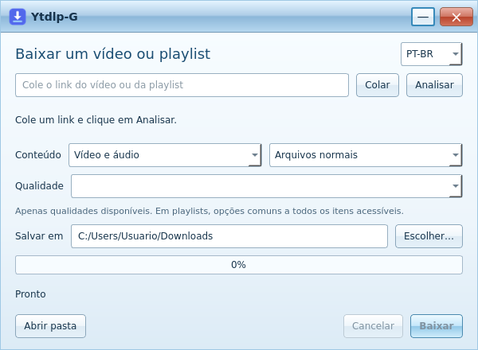

# Ytdlp-G

Aplicativo compacto para Windows 10/11 x64, com visual inspirado no Windows 7
Aero. Baixe vídeos, áudios e playlists, como arquivos normais ou em um único ZIP.
Não é necessário instalar Python.

[Baixar instalador](https://github.com/fuhbe/Ytdlp-G/releases/latest/download/Ytdlp-G-Setup.exe)
· [ZIP portátil](https://github.com/fuhbe/Ytdlp-G/releases/latest/download/Ytdlp-G-portable.zip)
· [Notas da versão e hashes](https://github.com/fuhbe/Ytdlp-G/releases/latest)

1. Cole o link e clique em **Analisar**.
2. Escolha conteúdo, qualidade disponível e arquivos normais ou ZIP.
3. Escolha a pasta e clique em **Baixar**.

Para MP3, escolha **Somente áudio → Qualidade → MP3 · Alta qualidade**. O app
baixa o melhor áudio disponível e converte para MP3 a 320 kbps; fontes já em MP3
são preservadas sem nova conversão. Converter não melhora a qualidade original.
Playlists mostram qualidades nativas comuns aos itens acessíveis.

No portátil, extraia todo o ZIP e abra `Ytdlp-G.exe`, mantendo as pastas e arquivos
ao lado dele. Os pacotes não são assinados e podem mostrar aviso do SmartScreen.
Windows 7 não é suportado; apenas o visual é inspirado nele.

A versão 1.2.0 passou por 78 testes no Windows e 19 verificações funcionais em
cada pacote, portátil e instalação. Consulte o [relatório](docs/VALIDATION.md).
O suporte a sites depende do yt-dlp e da disponibilidade da fonte.

[Código e guia completo em inglês](README.md) · [Reportar problema](https://github.com/fuhbe/Ytdlp-G/issues/new/choose).
Código próprio: [MIT](LICENSE); [dependências com licenças próprias](THIRD_PARTY_NOTICES.md).
