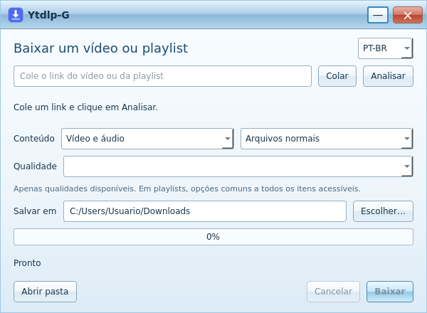

# Ytdlp-G

Aplicativo compacto para Windows 10/11 x64, com visual inspirado no Windows 7
Aero. Baixe vídeos, áudios e playlists, como arquivos normais ou em um único ZIP.
Não é necessário instalar Python.

[Baixar instalador](https://github.com/fuhbe/Ytdlp-G/releases/latest/download/Ytdlp-G-Setup.exe)
· [ZIP portátil](https://github.com/fuhbe/Ytdlp-G/releases/latest/download/Ytdlp-G-portable.zip)
· [Notas da versão e hashes](https://github.com/fuhbe/Ytdlp-G/releases/latest)

1. Cole o link e clique em **Analisar**.
2. Escolha conteúdo, qualidade disponível e arquivos normais ou ZIP.
3. Escolha a pasta e clique em **Baixar**.

**Vídeo:** escolha uma resolução disponível. O arquivo final é MP4 com áudio; faixas separadas são unidas e codecs incompatíveis são convertidos para H.264/AAC.

**Somente áudio:** a saída é sempre MP3. Preserva MP3 quando disponível; caso contrário, baixa o melhor áudio e converte para MP3 a 320 kbps. Converter não melhora a qualidade original. Funciona também com playlists e ZIP.

**Atualização do motor:** yt-dlp 2026.11.23 incluído, com verificação de novas versões estáveis uma vez por dia antes de analisar/baixar. Clique em **Atualizar motor** para verificar imediatamente. Não precisa reinstalar o app. Downloads oficiais do PyPI têm SHA256 verificado e scripts EJS correspondentes; falhas mantêm um motor utilizável.

No portátil, extraia todo o ZIP e abra `Ytdlp-G.exe`, mantendo as pastas e arquivos
ao lado dele. Os pacotes não são assinados e podem mostrar aviso do SmartScreen.
Windows 7 não é suportado; apenas o visual é inspirado nele.

A versão 1.3.0 é publicada após testes e verificações funcionais dos pacotes Windows. Consulte o [relatório](docs/VALIDATION.md) e `Ytdlp-G-validation.zip` no release. Os testes usam mídia gerada e servidor local. A tentativa de testar YouTube neste ambiente foi bloqueada pelo proxy (HTTP 403), portanto download real do YouTube não foi validado aqui. O suporte a sites depende do yt-dlp, da rede e da fonte.

[Código e guia completo em inglês](README.md) · [Reportar problema](https://github.com/fuhbe/Ytdlp-G/issues/new/choose).
Código próprio: [MIT](LICENSE); [dependências com licenças próprias](THIRD_PARTY_NOTICES.md).
