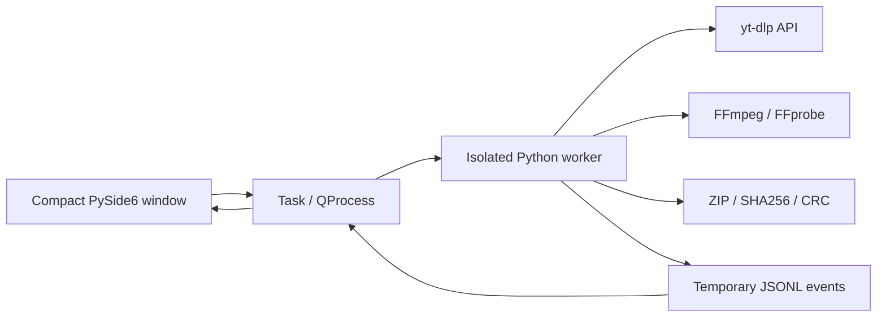

# Architecture

Ytdlp-G separates the Qt interface from media operations. Network extraction,
FFmpeg and archive work run outside the GUI thread.

## Interface and workers

`main.py` starts `ui/lite_window.py`. `Task` uses QProcess and Qt signals on the
main thread. Requests and events use private temporary files because a windowed
Windows executable has no normal `sys.stdout`. The UI reads incremental events
using a timer rather than parsing terminal output. Task cleanup removes request
and event files. Errors expose codes and exception classes without raw extractor
messages that could reveal URL parameters or headers.

`lite.py` analyzes source formats and computes quality choices shared by accessible
playlist entries. Native choices retain source codecs. The MP3 profile requests
the best available audio and converts it through FFmpeg at 320 kbps, preserving
native MP3 sources without another lossy encode. `worker.py` dispatches operations;
`downloader.py`, `media.py` and `archive.py` implement shared media services.

On POSIX, each worker has its own session; cancellation terminates the process
group, including FFmpeg. On Windows, `taskkill /T /F` terminates the tree without
opening a console. Cancellation stops work; it is not a guaranteed pause/resume
feature. Partial files may be reusable by yt-dlp, while interrupted post-processing
may need to start again.

## Files and archives

Downloads use `destination/.ytdlp-g/<id>` staging directories. Only successful
outputs are published. `publish()` copies into a temporary destination file,
flushes it and publishes without replacing existing files; collisions receive
suffixes. Windows uses a non-replacing rename; POSIX uses hard links. Unsupported
hard-link filesystems fail rather than exposing an incomplete final file.
Windows reserved names and unsafe characters are normalized. Very long paths
still depend on Windows and filesystem settings.

ZIP operations stream data, create safe relative member names and deduplicate
case-insensitively. Each member is verified against SHA256, and the final archive
passes CRC checks. Originals are removed only after verification and only if
size/mtime still match. Failures and cancellations preserve media. Forced process
termination may leave temporary files for later cleanup.

## Settings and translations

`Settings` atomically saves preferences. The installed app uses the user's data
directory; a portable marker selects a `data` directory beside the executable.
`Options` provides validated media settings shared with the service layer.
The three JSON catalogs have stable keys, tested parity and a Portuguese fallback.
Live language switching updates existing widgets while preserving entered data.
Media titles, codec names and versions are external data rather than translations.

Diagnostic logs record error codes and classes without raw yt-dlp errors.
Clipboard text is read by the compact window when the user clicks **Paste**.

## Retained classic implementation

`main_classic.py` and `ui/window.py` retain the previous advanced interface for
source development. This interface uses `Database`, `QueueManager` and `Scheduler`;
the compact app does not start them. SQLite WAL stores versioned queue/history
records and persistent ZIP groups. Interrupted tasks are recoverable, and scheduling
requires the classic app to remain open. Recurrence uses UTC intervals and skips
extra overdue occurrences after suspension.

See [CLASSIC-1.0.md](CLASSIC-1.0.md) for the historical feature reference and
[FEATURE_MATRIX.md](FEATURE_MATRIX.md) for the current supported interface.
