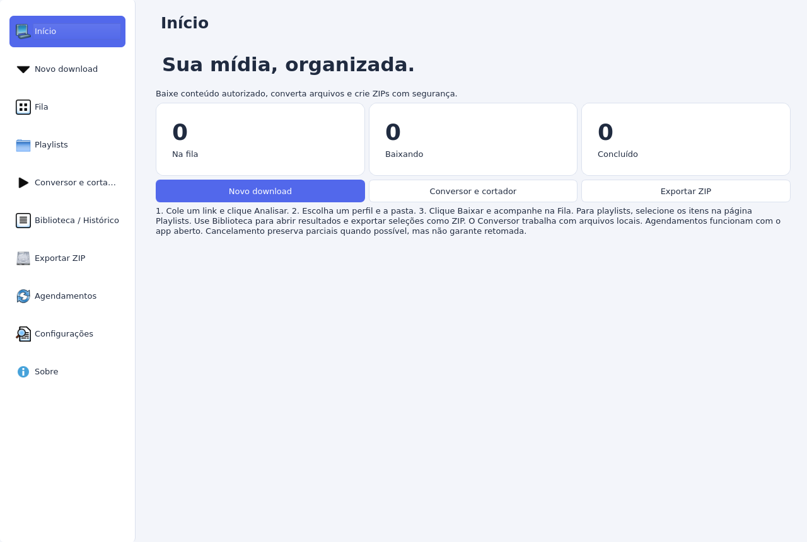

# Classic interface — historical developer reference

The current Windows release uses the compact interface described in the
[README](../README.md). The earlier classic interface remains in the source tree;
its release downloads have been retired.



## Run the retained interface from source

Prepare the development environment using [BUILD_WINDOWS.md](BUILD_WINDOWS.md),
then run:

```bash
python -m ytdlp_g.main_classic
```

The normal application entry point is `python -m ytdlp_g.main` and opens the
compact interface. Building the current Windows packages uses that normal entry point.

## Historical features

- Async URL inspection, metadata, thumbnails, streams, subtitles and chapters.
- Video/audio downloads, advanced format choices, remuxing and audio extraction.
- Playlist pagination, item selection, numbered output and persistent ZIP groups.
- SQLite queue with priority, concurrency, retries, cancellation and recovery.
- Regular files, ZIP or both; library export with SHA256/CRC verification.
- Local batch conversion and trimming with FFprobe inspection and progress.
- Searchable history, CSV/JSON export, editable profiles and preferences.
- One-time/daily/weekly schedules while the app is open, tray and notifications.
- Optional clipboard suggestions and SponsorBlock, disabled by default.
- English, Brazilian Portuguese and Spanish, with live language switching.

## Workflow

1. Open **New download**, paste links and analyze them.
2. Choose a profile, format, quality and destination, then start the download.
3. Monitor the queue. Cancel stops work; retry may reuse partial files when supported.
4. For playlists, enable playlist analysis and choose entries on the playlists page.
5. Open results in the library or select items to export a verified ZIP.

The converter and cutter operate on local media. Remuxing depends on container
and codec compatibility; lossy conversion can reduce quality. Converting a lossy
source to WAV or FLAC cannot restore missing detail.

## Data and limits

The classic interface stores local queue/history and settings in the same data
root described in [ARCHITECTURE.md](ARCHITECTURE.md). Exports can contain URLs;
review them before sharing. It does not import browser credentials or bypass DRM.
Schedules require the app to be open and do not wake a powered-off computer.

Remote updating, Windows Task Scheduler integration, automatic startup, split
ZIP files and URL-based trimming are not implemented. Manual DPI, accessibility,
tray and external-service coverage remains limited. Historical test evidence is
in [VALIDATION-1.0.md](VALIDATION-1.0.md); current release evidence is in
[VALIDATION.md](VALIDATION.md).
